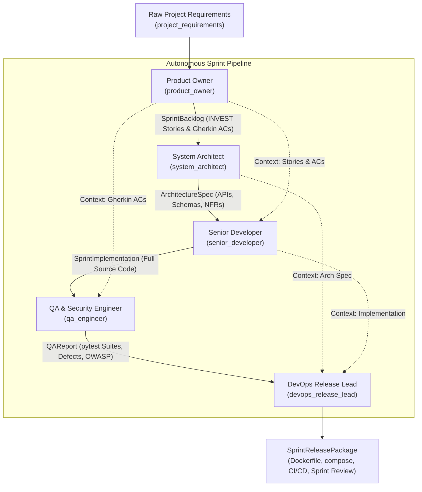

# Agile Dev Crew: Autonomous Multi-Agent Software Development Team

A production-ready, enterprise-grade multi-agent software engineering crew built with the [CrewAI](https://github.com/crewAIInc/crewAI) framework and Python 3.11+.

This system operationalizes the **Agile Scrum methodology**, taking raw product requirements and moving them autonomously through:
1. **Backlog Refinement** (Product Owner)
2. **System Architecture & Technical Design** (System Architect)
3. **Sprint Implementation & Coding** (Senior Developer)
4. **Automated QA & OWASP Security Audit** (QA Engineer)
5. **DevOps Deployment & Sprint Governance** (DevOps Release Lead / Scrum Master)

---

## Architecture & Data Contract Pipeline

All agent handoffs are strictly enforced using Pydantic `BaseModel` schemas via `output_pydantic`:



---

## Agent Roster

| Agent | Role | Core Responsibilities | Tools |
| :--- | :--- | :--- | :--- |
| **Product Owner** | Principal Product Strategist | Decomposes raw requirements into INVEST user stories, Gherkin scenarios, Fibonacci sizing, and Definition of Done. | Web/Market Search, FileReadTool |
| **System Architect** | Chief Systems Architect | Designs clean architecture, PostgreSQL/MongoDB schemas, REST/OpenAPI contracts, and NFRs. | FileReadTool, FileWriterTool, DirectoryReadTool |
| **Senior Developer** | Staff Full-Stack Engineer | Writes complete, modular, production-grade source code following SOLID principles and type safety. | FileWriterTool, FileReadTool, CodeInterpreterTool |
| **QA Engineer** | Lead SDET & Security Specialist | Writes automated pytest suites matching Gherkin ACs, conducts static code and OWASP Top 10 security audits. | CodeInterpreterTool, FileReadTool, FileWriterTool |
| **DevOps Release Lead** | Principal DevOps & Scrum Master | Creates multi-stage Dockerfiles, docker-compose, GitHub Actions CI/CD, and chairs Sprint Review / Retrospective. | FileWriterTool, FileReadTool, DirectoryReadTool |

---

## Quickstart with `uv`

### 1. Prerequisites
Ensure Python 3.11+ and `uv` are installed:
```bash
curl -LsSf https://astral.sh/uv/install.sh | sh
```

### 2. Environment Setup
Clone or navigate to the project directory:
```bash
cd /path/to/agents
cp .env.example .env
```
Fill in your API keys in `.env`:
```ini
OPENAI_API_KEY=sk-...
OPENAI_MODEL_NAME=gpt-4o
SERPER_API_KEY=...   # Optional: For web search tool
```

### 3. Install Dependencies
Sync dependencies into a managed virtual environment using `uv`:
```bash
uv sync
```

### 4. Execute the Sprint
Run the autonomous sprint pipeline:
```bash
uv run agile-dev-crew
# Or directly via Python:
uv run python -m agile_dev_crew.main
```

---

## Switching to Hierarchical Mode

By default, the orchestration runs in `Process.sequential` mode, which executes a deterministic linear sprint pipeline from refinement to release.

To enable **Hierarchical Mode** (where the DevOps Release Lead acts as the Agile Scrum Master / Engineering Manager delegating tasks and triggering rework loops between QA and Dev):

Edit `src/agile_dev_crew/crew.py`:
```python
@crew
def crew(self) -> Crew:
    return Crew(
        agents=self.agents,
        tasks=self.tasks,
        process=Process.hierarchical,              # <-- Switch to hierarchical
        manager_agent=self.devops_release_lead(),  # <-- Scrum Master manager
        # Or alternatively: manager_llm=ChatOpenAI(model="gpt-4o"),
        memory=True,
        verbose=True,
    )
```

---

## Output Artifacts

Upon completion of a sprint, the pipeline produces:
1. `output/deployment/Dockerfile`: Production multi-stage Dockerfile.
2. `output/deployment/docker-compose.yml`: Multi-service orchestration file.
3. `output/deployment/.github/workflows/ci.yml`: Full GitHub Actions CI/CD pipeline.
4. `output/deployment/.env.example`: Documented production environment template.
5. `output/deployment/sprint_review.json`: Complete Sprint Review summary, velocity metrics, test sign-offs, and Kaizen retrospective insights.
