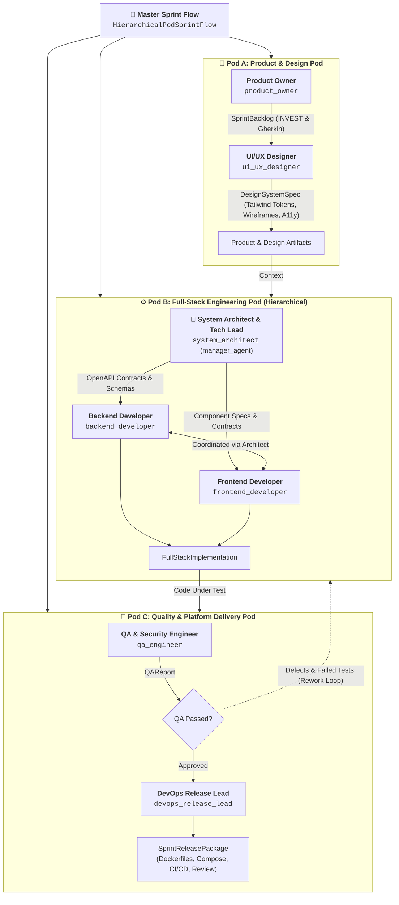

# Agile Dev Crew: Autonomous Multi-Pod Software Engineering Team

A production-grade, enterprise-grade multi-agent software engineering system built with the [CrewAI](https://github.com/crewAIInc/crewAI) framework and Python 3.11+.

This system operationalizes **Approach 3: Hierarchical Cross-Functional Pods (Multi-Crew Orchestration)**, structuring 7 specialized agents into 3 collaborative pods coordinated by an event-driven master Flow with an automated QA rework loop.

---

## 🏛️ Pod Breakdown & Agent Roster



---

## 7 Specialized Agent Personas

| Pod | Agent | Role | Core Responsibility |
| :--- | :--- | :--- | :--- |
| **Pod A** | **Product Owner** (`product_owner`) | Principal Product Strategist | Decomposes raw requirements into INVEST user stories, Gherkin acceptance criteria, Fibonacci sizing, and Definition of Done. |
| **Pod A** | **UI/UX Designer** (`ui_ux_designer`) | Lead Design Systems Architect | Designs modern Tailwind CSS design tokens, atomic UI component states, responsive wireframe layouts, and WCAG 2.1 AA a11y specifications. |
| **Pod B** | **System Architect** (`system_architect`) | Principal Systems Architect & Pod Manager | Acts as Engineering Manager for Pod B; designs clean architecture, normalized DB schemas, and REST/OpenAPI contracts while directing developers. |
| **Pod B** | **Backend Developer** (`backend_developer`) | Senior Backend Systems Engineer | Implements production-grade FastAPI REST endpoints, SQLAlchemy/SQLModel models, domain business logic, connection pooling, and HMAC authentication. |
| **Pod B** | **Frontend Developer** (`frontend_developer`) | Senior Frontend Engineer | Implements Next.js 14 App Router views, React 18 components, client state hooks, and API integration matching the UI/UX tokens and OpenAPI schemas. |
| **Pod C** | **QA Engineer** (`qa_engineer`) | Lead SDET & Security Specialist | Writes automated pytest suites for backend APIs, component test verification, conducts static code audit, OWASP Top 10 evaluation, and WCAG a11y checks. |
| **Pod C** | **DevOps Release Lead** (`devops_release_lead`) | Principal DevOps & Scrum Master | Creates multi-stage Dockerfiles for backend and frontend, root docker-compose.yml, GitHub Actions CI/CD pipeline, and chairs the Sprint Review. |

---

## 🔄 Self-Healing QA Rework Loop

The Flow maintains an autonomous feedback loop:
1. When **QA Engineer** detects failing tests or defects in Pod C, the `@router` intercepts the failure.
2. The router increments the iteration counter (`max_iterations = 3`) and routes the defect payload back to **Pod B**.
3. In Pod B, the **System Architect** receives the defect log, separates backend vs. frontend defects, and directs the respective developer to fix root causes.
4. Once QA signs off (`sign_off_status == "APPROVED"` and `failed_tests == 0`), the router directs to the **DevOps Release Lead** for release deployment.

---

## 🚀 Quickstart with `uv`

### 1. Prerequisites
Ensure Python 3.11+ and `uv` are installed:
```bash
curl -LsSf https://astral.sh/uv/install.sh | sh
```

### 2. Configure Environment
```bash
cp .env.example .env
```
Provide your API keys in `.env`:
```env
OPENAI_API_KEY=sk-...
OPENAI_MODEL_NAME=gpt-4o
SERPER_API_KEY=...   # Optional: For web search tool
```

### 3. Install Dependencies
```bash
uv sync
```

### 4. Run the Autonomous Multi-Pod Sprint

#### Event-Driven Multi-Pod Flow (Approach 3):
```bash
uv run agile-dev-flow
# Or directly via Python:
uv run python -m agile_dev_crew.main
```

#### Unified 7-Agent Linear Pipeline:
```bash
uv run agile-dev-crew
# Or directly via Python:
uv run python -m agile_dev_crew.main --linear
```

---

## 📦 Output Artifacts

Upon completion of a sprint, the system exports full-stack deployment assets to `output/deployment/`:
- `Dockerfile.backend`: Multi-stage Python 3.12 / FastAPI container.
- `Dockerfile.frontend`: Multi-stage Node.js / Next.js 14 container.
- `docker-compose.yml`: Multi-service orchestration (Postgres, Redis, Backend, Frontend).
- `.github/workflows/ci.yml`: Full GitHub Actions CI/CD pipeline.
- `.env.example`: Documented production environment configuration.
- `sprint_review.json`: Sprint Review summary, velocity metrics, test sign-offs, and Kaizen retrospective insights.
