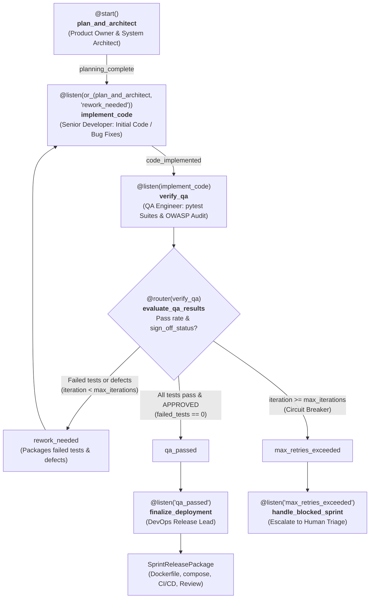

# Agile Dev Crew: Autonomous Multi-Agent Software Development Team

A production-ready, enterprise-grade multi-agent software engineering system built with the [CrewAI](https://github.com/crewAIInc/crewAI) framework and Python 3.11+.

This system operationalizes the **Agile Scrum methodology**, moving raw product requirements through:
1. **Backlog Refinement** (Product Owner)
2. **System Architecture & Technical Design** (System Architect)
3. **Sprint Implementation & Remediation** (Senior Developer)
4. **Automated QA & OWASP Security Audit** (QA Engineer)
5. **DevOps Deployment & Sprint Governance** (DevOps Release Lead / Scrum Master)

---

## 🌊 Event-Driven Flow Architecture (`AgileSprintFlow`)

The system implements an autonomous, self-healing **CrewAI Flow** (`@start`, `@listen`, `@router`) that routes failed QA test reports back to the Senior Developer until all tests pass:



---

## Agent Roster

| Agent | Role | Core Responsibilities | Tools |
| :--- | :--- | :--- | :--- |
| **Product Owner** | Principal Product Strategist | Decomposes raw requirements into INVEST user stories, Gherkin scenarios, Fibonacci sizing, and Definition of Done. | Web/Market Search, FileReadTool |
| **System Architect** | Chief Systems Architect | Designs clean architecture, PostgreSQL/MongoDB schemas, REST/OpenAPI contracts, and NFRs. | FileReadTool, FileWriterTool, DirectoryReadTool |
| **Senior Developer** | Staff Full-Stack Engineer | Writes complete, modular, production-grade source code; remediates QA defects. | FileWriterTool, FileReadTool, CodeInterpreterTool |
| **QA Engineer** | Lead SDET & Security Specialist | Writes automated pytest suites matching Gherkin ACs, conducts static code and OWASP Top 10 security audits. | CodeInterpreterTool, FileReadTool, FileWriterTool |
| **DevOps Release Lead** | Principal DevOps & Scrum Master | Creates multi-stage Dockerfiles, docker-compose, GitHub Actions CI/CD, and chairs Sprint Review / Retrospective. | FileWriterTool, FileReadTool, DirectoryReadTool |

---

## Quickstart with `uv`

### 1. Prerequisites
Ensure Python 3.11+ and `uv` are installed:
```bash
curl -LsSf https://astral.sh/uv/install.sh | sh
```

### 2. Environment Setup
```bash
cp .env.example .env
```
Fill in your API keys in `.env`:
```ini
OPENAI_API_KEY=sk-...
OPENAI_MODEL_NAME=gpt-4o
SERPER_API_KEY=...   # Optional: For web search tool
```

### 3. Install Dependencies
```bash
uv sync
```

### 4. Execute the Sprint

#### Option A: Event-Driven Flow with QA Rework Loop (Recommended)
```bash
uv run agile-dev-flow
# Or directly:
uv run python -m agile_dev_crew.main
```

#### Option B: Linear Sequential Sprint Pipeline
```bash
uv run agile-dev-crew
# Or with CLI flag:
uv run python -m agile_dev_crew.main --linear
```

---

## Output Artifacts

Upon completion of a sprint, the pipeline produces:
1. `output/deployment/Dockerfile`: Production multi-stage Dockerfile.
2. `output/deployment/docker-compose.yml`: Multi-service orchestration file.
3. `output/deployment/.github/workflows/ci.yml`: Full GitHub Actions CI/CD pipeline.
4. `output/deployment/.env.example`: Documented production environment template.
5. `output/deployment/sprint_review.json`: Complete Sprint Review summary, velocity metrics, test sign-offs, and Kaizen retrospective insights.
